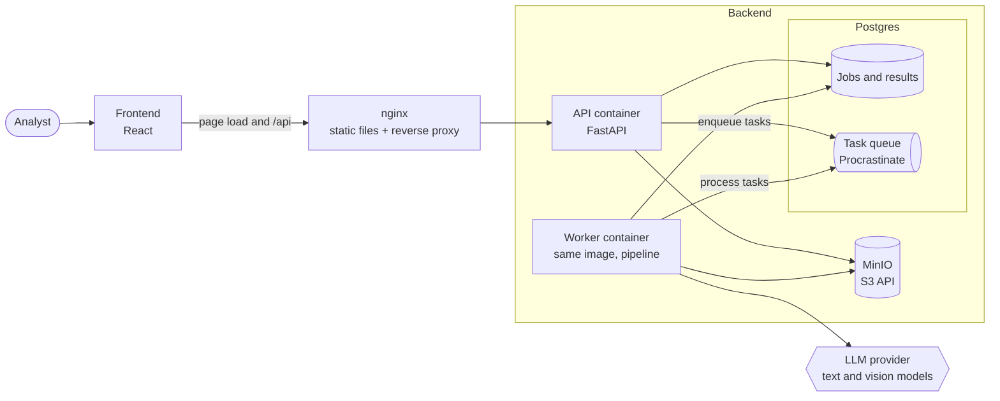
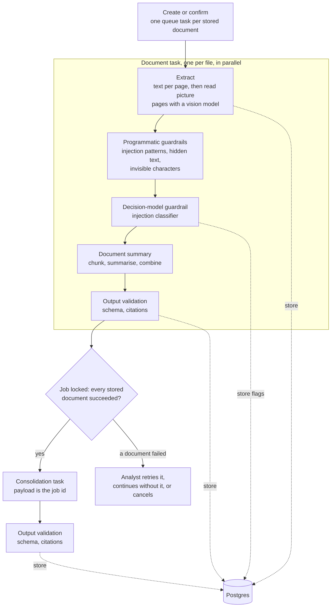
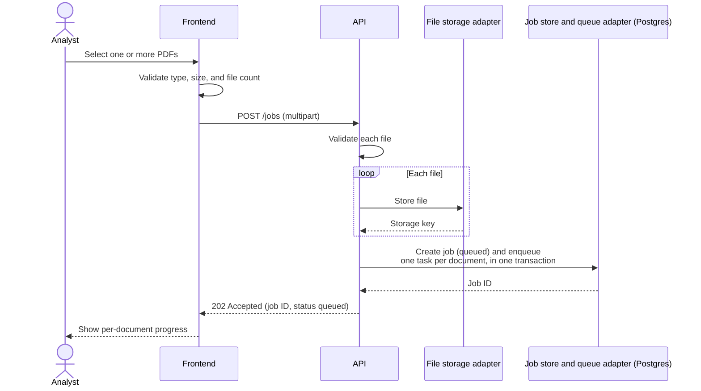
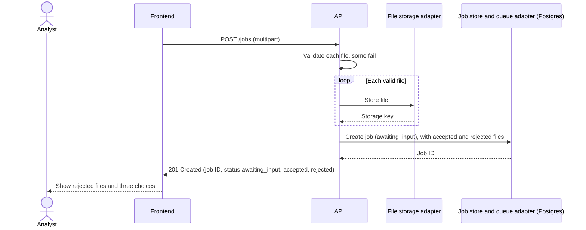
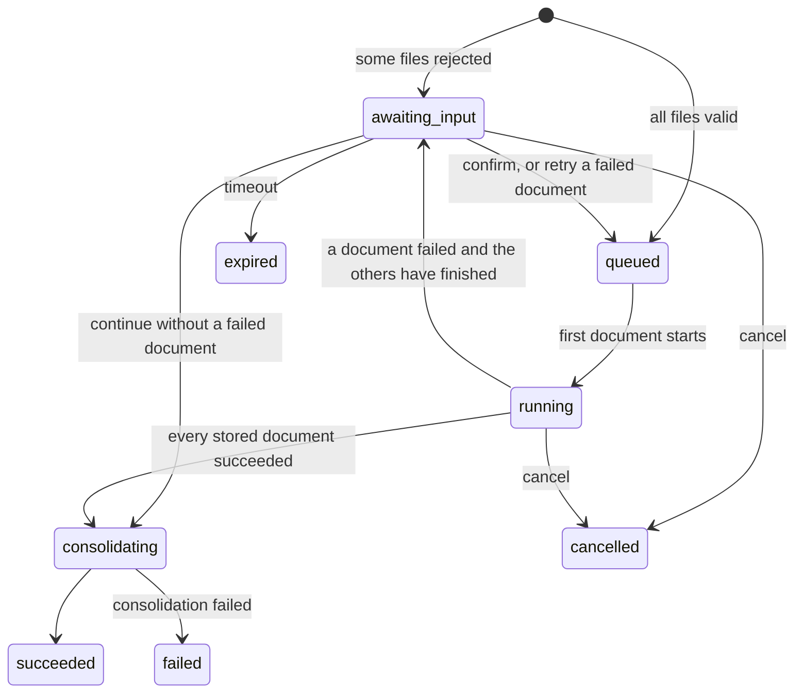

# doc-insight


## Solution overview

Doc Insight turns a batch of PDFs into one short report. Each file gets a summary, and one overview covers them all.

The focus is easy-to-digest headlines, accurate summaries, and readability:

- Every summary starts with a one-line headline and a few short points.
- Every key detail shows its page and a quote.
- When documents disagree, both sides are shown.

It also reads text in images, flags prompt injection, and exports the report as a PDF.

You can try it with the sample PDFs in [samples/](samples/):

- [flows/](samples/flows/): one set that works, and one set with a file the upload rejects.
- [adversarial/](samples/adversarial/): documents that get flagged.
- [invalid/](samples/invalid/): files the upload rejects.
- [output/](samples/output/): example summaries made from the `flows/` files, using Doc Insight.

## Design & Planning

I aimed to build most of this in 48 hours, including half a day of planning.

To move that fast, I knew I had to build with AI agents, and still understand the code. Agents have limited context and follow the conventions they find. So I planned to spend the early time on a strong base: scaffolding (see the commit history), rules, and system design, so the agents had clear rules to follow.

How I planned it:

1. Analysed the requirements.
2. Set up the monorepo with CI, linting and commit hooks, and enforced them.
3. Recorded key decisions as I made them.
4. Wrote reusable prompts for work I expected to repeat.
5. Set up the frontend and backend, and containerised them early.
6. Set up testing and security checks, such as gitleaks.
7. Wrote down the design direction: adapters, strategies and factories so providers are easy to swap, and async processing with queues so it can scale.
8. Wrote a Product Requirements Document and an execution plan, split into prioritised tasks.
9. Researched industry approaches to check the design.
10. Ordered the phases by what is testable and can be deployed on its own.
11. Set up Bruno before development, to test the backend quickly.
12. Built with agents, checked each task by hand, and adjusted along the way.
13. Tagged pre-releases on GitHub to mark milestones.

Key decisions made during development are logged in [decision-record.md](context/decision-record.md).

## Architecture

### System components



### LLM processing pipeline



### Upload flow

#### All files valid



#### Some files rejected



#### Job states



More detail is in [architecture.md](context/architecture.md).

## Setup Instructions

> This section is for running the app. For development (tests, linting, dev servers), see [CONTRIBUTING.md](CONTRIBUTING.md) instead.

### 1. Install the tools

You only need **Git** and **Docker with Compose v2**. You do not need Node, pnpm, Python or uv. The images build everything inside Docker.

Install Docker for your system:

- **macOS**: [Docker Desktop](https://docs.docker.com/desktop/setup/install/mac-install/), or [Colima](https://github.com/abiosoft/colima) (free and open source):

  ```bash
  brew install colima docker docker-compose
  mkdir -p ~/.docker
  ```

  Add this to `~/.docker/config.json` so Docker finds the Compose plugin (on Intel Macs, use `/usr/local` instead of `/opt/homebrew`):

  ```json
  "cliPluginsExtraDirs": ["/opt/homebrew/lib/docker/cli-plugins"]
  ```

  Then start the engine with `colima start`. Run it again after a reboot.

- **Windows**: [Docker Desktop](https://docs.docker.com/desktop/setup/install/windows-install/) with the WSL 2 backend. Open the app so the engine is running.
- **Linux**: [Docker Engine](https://docs.docker.com/engine/install/) with the [Compose plugin](https://docs.docker.com/compose/install/linux/). Colima also works.

Check that it works:

```bash
docker compose version
```

You also need internet access for the first build, which downloads the base images, and these ports free: 8080, 8000, 5432, 9000 and 9001.

### 2. Get the code

```bash
git clone https://github.com/nc1z/doc-insight.git
cd doc-insight
```

### 3. Set the environment

Copy the example file to the repo root:

```bash
cp .env.example .env
```

I chose **Cloudflare AI Gateway** as the default provider, and built the providers behind adapters so they can be swapped. I have not tested other providers, because of the time limit.

Pick one:

- **Cloudflare (default)**: fill in these values in `.env`. You need a Cloudflare account with an AI Gateway that uses Unified Billing, and an API token that can run Workers AI.
  - `CLOUDFLARE_ACCOUNT_ID`
  - `CLOUDFLARE_AI_GATEWAY_ID` (only if your gateway is not named `default`)
  - `LLM_API_KEY` (also used to read images)
  - `CLASSIFIER_API_KEY`
- **Mock**: no account or key needed. Set `LLM_PROVIDER`, `CLASSIFIER_PROVIDER` and `VISION_PROVIDER` to `mock` in `.env`. Mock mode shows the whole flow without calling a model, so the summaries are placeholders.

The API and worker will not start with the example file as it is, because the Cloudflare values are empty.

### 4. Run it

```bash
docker compose up -d --build --wait
```

The first run builds the images, so it takes longer.

- App: <http://localhost:8080>
- API: <http://localhost:8000> (also served by the app under `/api`)

Try it with the PDFs in [samples/](samples/).

Stop it with `docker compose down`. Your data stays in Docker volumes. Add `-v` to delete it too.

## Demo - Video / Screenshots


### 1. Happy Path - PDFs with text and images
[ai-competitor-landscape.pdf](samples/flows/happy-path/ai-competitor-landscape.pdf) contains images which was successfully analysed and summarized, alongside a few other important documents.

https://github.com/user-attachments/assets/52b37ad0-24f3-4660-8b0d-313ead6c0233

### 2. Failure Path - Invalid PDFs, Adversarial Content

Failures are handled even in the pipeline steps (even though the video doesn't show it), and allows the analyst to retry or continue. This ensures the analyst knows if certain context is left out and makes the decision.

https://github.com/user-attachments/assets/3c740be7-8663-43f2-b323-94dad0e4cfa5

## Assumptions Made

- **"Regularly receives multiple documents"**: this is a routine, business-as-usual task. I assume the analyst wants to track past analyses and download the summary.
- **"Requires a quick way to understand their contents"**: the analyst makes decisions based on the summary, so accuracy matters more than speed. "Quick" is subjective. Studying the documents by hand can take very long, so even a slower, higher-quality summary is still faster than that.
- **Context and quality of the output matter**, because decisions are made from it. So when a document fails, the analyst can retry it. If they continue without it, they know it will be left out.
- **The requirements describe a POC**, so authentication and RBAC are out of scope.
- **One topic per batch**: the documents in an upload are about the same subject, so one combined report makes sense.
- **A flagged document still continues**: a file that looks like prompt injection may still hold the content the analyst needs. So the job keeps going, and the document is shown with a warning and the reasons. Guardrails make sure its instructions are never followed: the text is marked as data, and the model has no tools to act with.
- **Disagreements are kept, not merged**: when documents disagree on content, the report says so and shows both sides, with the file, page and quote for each. Picking one would hide the disagreement from the analyst.
- **Documents go to a hosted model**: the document content is sent to an inference provider, and I used Cloudflare as the default for this project. If the documents are sensitive, production would use a self-hosted model or an approved provider.
- **PDF only**: other file types are out of scope. I did consider them, and I built file validation as a list of strategies, so adding a type is less painful.
- **Retention**: a job waiting for the analyst's decision expires after 24 hours, and its files are deleted. A stored file with no job is deleted after 1 hour.
- **Security is a baseline**: this is a POC, so I covered the basics: file validation, prompt-injection guardrails, secret scanning with gitleaks, and a minimum age for new packages. In production on a cloud like AWS, I would add GuardDuty and malware scanning of uploaded files.

## Known Limitations

- **Speed depends on the model**: how long a summary takes depends on the inference provider, the model and its thinking level. If a step runs past the 300 second limit, that document fails and the analyst retries it.
- **History is per browser**: past reports are kept as job IDs in local storage, and no endpoint lists jobs. Clearing the browser or switching browsers loses them.
- **No login**: anyone who knows a job ID can open that job.
- **PDF only**: uploads and the report download are PDF only.
- **Limits on what it reads**: uploads are capped at 20 MB, 100 pages and 10 files, and at most 16 image pages per file go to the vision model.
- **Basic retries**: retries use backoff and jitter, but `Retry-After` is not honoured, and the text and injection-check calls do not treat client errors differently from rate limits and server errors.
- **Injection detection is not perfect and can be improved**: it combines pattern checks, a classifier and a model told to treat the text as data. A clever attack may still get through.
- **A reader error fails the file**: a page is never skipped, so a chart cannot be silently ignored.
- **Not built yet**: automated evals scoring, caching of repeated uploads, live progress with server-sent events, and malware scanning.
- **Best fit for the scope and time, not the best possible**: with the scope and time I had, this was the best solution I chose. I know there are better options, such as Airflow DAGs for ETL-style pipelines.
