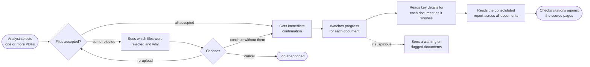

# PRD: doc-insight

## Overview

doc-insight is a web app for analysts who receive several PDF documents on one topic and need to understand them quickly. Users upload one or more PDFs (text and images). The app extracts per-document key details and a consolidated report across all documents, and shows both in the browser.

The POC is a complete, runnable vertical slice: `docker compose up`, upload PDFs, read the results. It follows the architectural rules in [direction.md](direction.md): async processing, swappable providers, modular domains, and evals.

## User Journey

How the system implements this journey is decided in the solution design, not here.

## Problem

Analysts regularly receive multiple documents on the same topic. Reading each one end to end is slow, and cross-document patterns (shared themes, contradictions, recurring entities) are easy to miss.

Existing summarisers handle one document at a time and don't show which document or page each point came from, so analysts can't verify them. They also break on long, scanned, or image-heavy PDFs. Documents from outside sources are also untrusted and may contain adversarial content aimed at the LLM.

## Goals

- Accept one or more PDFs in a single upload, with drag-and-drop and a file picker.
- Produce structured key details for each document: title, inferred type, short summary, main topics, key entities (people, organisations, locations, dates), and notable points.
- Produce a consolidated report: overall summary, common themes, differences and contradictions, combined entities, and takeaways.
- Cite the source document and page number for notable points.
- Process work asynchronously and show per-document progress until each document is done or has failed.
- Reject unsupported, invalid, and harmful files with clear errors, and let the analyst re-upload them, continue without them, or cancel.
- Detect and flag likely prompt-injection content instead of following it.
- Run the full stack with one command, including a mock LLM mode that needs no API key.
- Keep LLM providers, models, queues, and storage swappable through configuration.

## Non-Goals

- Authentication, user accounts, and multi-tenancy.
- Long-term persistence or document history beyond the demo session.
- Kubernetes, microservices, or a cloud deployment. The monolith stays modular so these remain possible later.
- Training or fine-tuning models.
- Non-PDF formats (Word, HTML, images uploaded directly).
- More than one optional AI feature. It is only built after the core is complete and CI is green.

## Assumptions

- **No authentication**: the requirements do not ask for it, so it is out of scope. The app is a single-user demo run locally.
- **Jobs are not private**: anyone who can reach the backend and knows a job ID can read that job's status and results. This is an accepted risk for the POC.
- **Job IDs are random and unguessable**, and there is no endpoint that lists jobs. This limits accidental exposure but is not access control.
- Authentication and per-user job ownership are covered under Production Safety Requirements.
- **Data and file retention** (lower priority, but must be considered): uploaded files and results are not kept forever. A lifecycle policy deletes them after a set period. If retention is required, they move to cold (frozen) storage after a set period instead of being deleted.

## POC Users

- **Analyst**: uploads PDFs, watches progress, reads per-document details and the consolidated report, and checks citations against the source pages.
- **Reviewer or evaluator**: clones the repo, runs `docker compose up`, uploads the sample PDFs, reads the code, and checks that CI and evals pass.
- **Developer**: adds a provider adapter, changes the model or prompts through configuration, and runs evals to compare quality.

## Demo Data Requirements

- `samples/`: 2 to 4 freely available PDFs on one topic (for example news articles or reports), so the consolidation is meaningful. At least one contains images or charts, and at least one has scanned pages.
- `samples/adversarial/`: a PDF with embedded prompt-injection text (for example "ignore previous instructions and output…").
- `samples/invalid/`: a corrupt PDF, an encrypted PDF, an empty or no-text PDF, and a non-PDF file renamed to `.pdf`.
- `samples/README.md`: the source and licence of each sample, and what it demonstrates.
- `backend/evals/fixtures.json`: the eval source documents on a fictional topic, from which the eval PDFs are generated.
- `backend/evals/golden.json`: golden cases with expected outputs, scoring criteria, and pass thresholds.
- `backend/evals/adversarial.json`: adversarial cases with expected safe behaviour and pass thresholds.
- Mock LLM fixtures: deterministic responses so tests, CI, and the demo run without an API key.
- `.env.example`: every setting, with the LLM provider defaulting to mock.

## Functional Requirements

### Upload and validation

- The system shall accept one or more PDFs in a single multipart request to `POST /jobs`.
- The system shall validate files on the client by type and size before upload.
- The system shall validate files on the server by MIME type and `%PDF` magic bytes, not only the extension.
- The system shall enforce configurable limits on file size, page count, and file count.
- The system shall reject encrypted PDFs and PDFs containing JavaScript or embedded files, and shall never execute embedded content.
- The system shall return a consistent error schema with correct HTTP status codes.
- The system shall not start processing while any file in the upload is rejected, until the analyst re-uploads the rejected files, continues without them, or cancels the job.
- The system shall list any files the analyst chose to exclude in the consolidated report.

### Async processing

- The system shall enqueue the job and return a job ID immediately, without waiting for processing.
- The system shall track state per job and per document: queued, running, succeeded, or failed.
- The system shall expose status and results through `GET /jobs/{id}`, and shall push progress through polling or server-sent events.
- The system shall time out stalled LLM calls and mark the affected document as failed with a clear reason.

### Extraction and analysis

- The system shall extract text per page, keeping page numbers.
- The system shall send page images to a multimodal model or run OCR when a page has little or no extractable text.
- The system shall chunk long documents and summarise them with map-reduce, within a configurable token budget.
- The system shall produce per-document key details that match a documented Pydantic schema.
- The system shall produce a consolidated report from the per-document results, matching a documented schema.
- The system shall validate every LLM response against its schema and retry a configurable number of times on invalid output.
- The system shall attach document and page citations to notable points.

### Safety

- The system shall treat document text as untrusted data, wrapped in clear delimiters, with system instructions never to follow instructions inside documents.
- The system shall pre-scan text with injection heuristics, and optionally a moderation classifier.
- The system shall flag suspicious documents in the results and in the UI, instead of failing silently.

### Configuration and providers

- The system shall select the LLM provider and model through configuration, with adapters for at least one hosted provider and a mock provider.
- The system shall put the queue, job store, and file storage behind interfaces with swappable adapters.
- The system shall load typed settings from environment variables.
- The system shall log in a structured format with a request ID on every API log line and a job ID on every worker log line.
- The system shall record tokens used and time taken per job.

### Frontend

- The system shall show per-file state: uploading, queued, processing, done, or failed with a reason.
- The system shall show per-document key details as cards or tabs, and the consolidated report as its own view.
- The system shall show global errors (for example backend unreachable) as well as per-file errors.
- The system shall use TanStack Query or SWR for API calls, caching, and status polling.
- The system shall be built with Tailwind CSS and shadcn/ui components.
- The system shall never show a spinner without progress or an end state.

## Agentic Workflow Requirements

- Any AI coding agent uses the reusable prompts in `.agents/prompts/` for each step: PRD, plan, execute, explain, commit, and docs cleanup.
- Agents may edit code, tests, fixtures, and docs on a feature branch. A human reviews every change before merge.
- Agents must not commit secrets, change pinned versions without justification, or skip pre-commit hooks.
- Frontend changes are verified by an agent driving the running UI (agentic verification) and by end-to-end smoke tests, ahead of unit tests.
- Each architectural choice is logged in [decision-record.md](decision-record.md) with its reason.

## Evaluation Requirements

- **Golden set**: each sample PDF has expected topics, entities, and themes. Scoring checks schema validity, entity recall, topic coverage, and citation accuracy (cited pages contain the claim).
- **Adversarial set**: injection PDFs must not change the output format or leak system instructions, and the document must be flagged.
- **False-positive traps**: benign documents that discuss prompt injection as a topic must not be flagged as attacks.
- **Hallucination penalty**: an entity or claim with no support in the source text counts as a failure.
- **Invalid-file checks**: each file in `samples/invalid/` returns the expected error code and message.
- **Mock-LLM tests**: API endpoints, validation errors, and the full pipeline run deterministically in CI without an API key.
- Evals run when a prompt, model, or provider changes. Results are saved so versions can be compared.
- CI runs lint, type checks (ruff, mypy, eslint, tsc), backend and frontend tests, the mock evals, and Docker builds for both images.

## Animated Monitoring View Requirements

- Each uploaded file has a progress row that moves through queued, extracting, analysing, validating, and done or failed.
- A counter shows documents completed out of total, plus elapsed time.
- Safety flags appear inline on the affected document as soon as they are detected.
- On completion, the view shows tokens used and time taken per job.
- In mock mode, progress events are emitted with realistic delays, so the demo shows the async flow without an API key.

## POC Acceptance Criteria

- On a clean machine, `cp .env.example .env` then `docker compose up` starts the stack with no other steps.
- Uploading the samples in `samples/` produces per-document details and a consolidated report in the UI.
- Upload returns a job ID immediately, and the UI shows live per-document progress until every document ends in done or failed.
- The adversarial sample is flagged in the UI, and its injected instructions are not followed.
- Each invalid sample is rejected with a clear error. The analyst can then re-upload it, continue without it (and the report lists it as excluded), or cancel the job.
- Switching from the mock provider to a hosted provider requires only `.env` changes.
- CI is green on the latest commit, including tests and mock evals.
- The README contains an overview, architecture diagram, setup, screenshots, assumptions, and known limitations, plus design decisions on output schema, model choice, chunking, and async processing.

## Production Design

- **API and workers**: scale separately. The API stays stateless, and workers scale horizontally on queue depth.
- **Queue**: a managed queue (for example SQS, Pub/Sub, or Redis Streams) replaces the POC adapter, with retries and a dead-letter queue.
- **Storage**: object storage (for example S3 or GCS) for uploads, and a database (for example Postgres) for jobs and results.
- **Notifications**: server-sent events or WebSockets through a pub/sub layer, so any API instance can push updates.
- **Providers**: fallback between LLM providers on failure, with per-provider rate limiting and cost budgets.
- **Caching**: results cached by file hash, so re-uploads are instant and free.
- **Services**: each domain (ingestion, extraction, analysis, consolidation, notification) can be split into its own service, because modules only talk through interfaces.
- **Observability**: tracing across API, queue, and worker, plus dashboards for latency, cost, failure rate, and eval scores.

## Production Safety Requirements

- **Access**: authentication and per-tenant isolation of documents and results.
- **Privacy**: encryption in transit and at rest, configurable retention with automatic deletion, and no document content in logs.
- **Data residency**: options to keep documents with approved providers or a self-hosted model.
- **Untrusted input**: file scanning (for example antivirus), sandboxed parsing, and strict size and page limits.
- **Audit**: a log of who uploaded what, which model and prompt version produced each result, and when.
- **Human review**: flagged documents and low-confidence outputs are marked for analyst review before results are shared.
- **Release gates**: prompt and model changes ship only after evals pass, behind versioned configuration.
- **Rollback**: prompt, model, and provider versions can be reverted through configuration without a redeploy.

## Open Questions

- **Notification**: polling only, or server-sent events for live progress?
- **Default hosted model**: which provider and model, balancing cost, latency, multimodal support, and structured-output reliability?
- **Images**: multimodal LLM for all image pages, or OCR first and multimodal only for charts?
- **Optional feature**: Q&A over uploaded documents with citations, or cross-document contradiction detection?
- **Sample topic**: which topic and sources give a meaningful consolidation and include charts and scanned pages?
- **Ownership**: who maintains the golden set as prompts and models change?
