# Architecture

Solution design for doc-insight. Product requirements live in [PRD.md](PRD.md), the architectural rules in [direction.md](direction.md), and the literature behind the pipeline design in [industry-insights.md](industry-insights.md).

## System components (POC)

_This is what we are building._

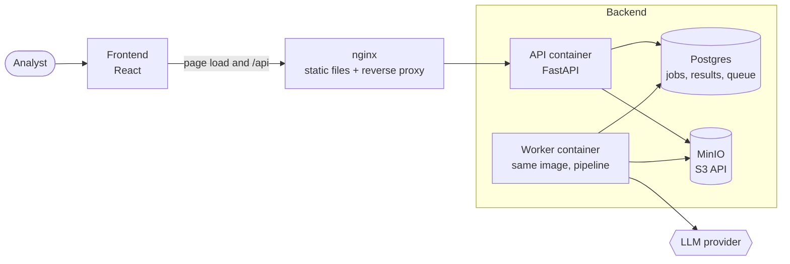

The API and the worker are separate containers from the same image. The API container runs the HTTP server. The worker container runs `python -m app.worker` and claims queue tasks. Processing capacity is the worker: it reads files from MinIO and writes status back to Postgres, so a long job stays off the process that serves uploads and polls. Extra worker containers add processing capacity without extra API containers. The two containers meet only through Postgres and MinIO.

## System components (production AWS)

_Envisioned architecture if we were to go to production._ These parts swap in through adapters, with no changes to API or worker logic:

- **Queue**: Postgres queue to SQS, with an outbox behind the same create-and-enqueue operation.
- **File storage**: MinIO to AWS S3, a configuration change (endpoint, bucket, and keys). The adapter stays the same.
- **LLM provider**: mock or hosted model to Bedrock or another provider.
- **Job store**: Postgres to RDS Postgres, a configuration change only.

Hosting (nginx to CloudFront and a load balancer) is an infrastructure change, not a code change. Authentication with Cognito is new work, not a swap.

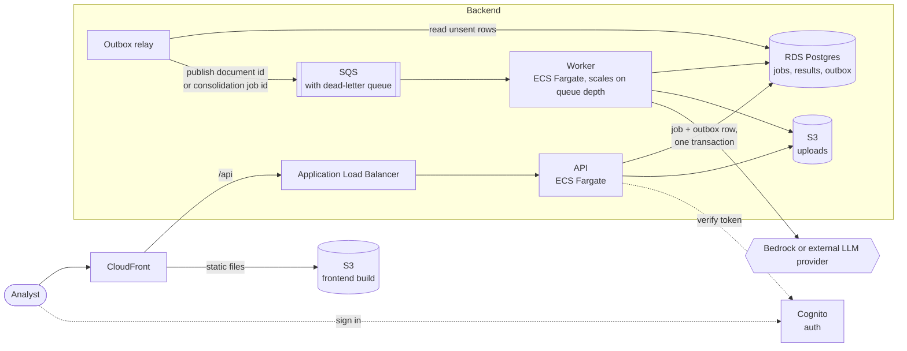

## Upload flow

What happens from the moment the analyst selects files until the job is queued. Processing by the worker is a separate flow.

A job only starts when every file is accepted, or when the analyst explicitly chooses to continue without the rejected ones.

### Happy path: all files valid

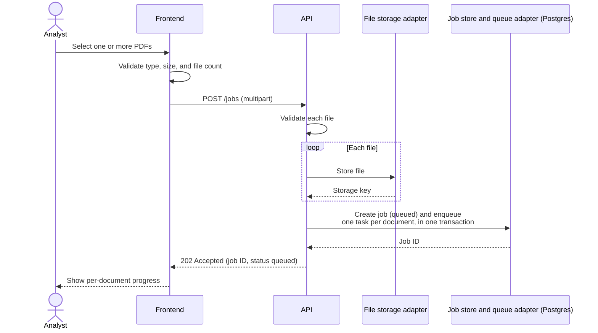

- **Validation happens twice.** The client check gives fast feedback. The server check is the one that is enforced, because client checks can be bypassed.
- **Server validation** checks MIME type, `%PDF` magic bytes, size, page count, encryption, and JavaScript or embedded files. A file that fails is a per-file rejection. Size, page, and file-count limits use that same result with `422`, including a whole upload that has too many files.
- **Files rejected on the client** are shown with reasons before upload, so the analyst can replace or remove them first.
- **`202 Accepted`** means the job is queued, not that it has finished. The UI follows progress through the [status flow](#status-flow).

### Negative case: all files rejected

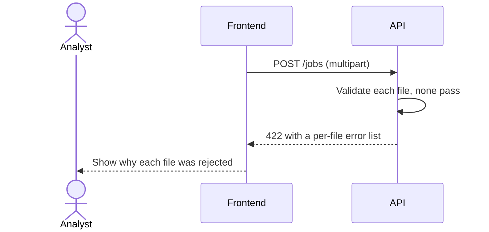

No files are stored and no job is created, so there is nothing to clean up. The analyst selects new files and starts again.

### Negative case: some files rejected

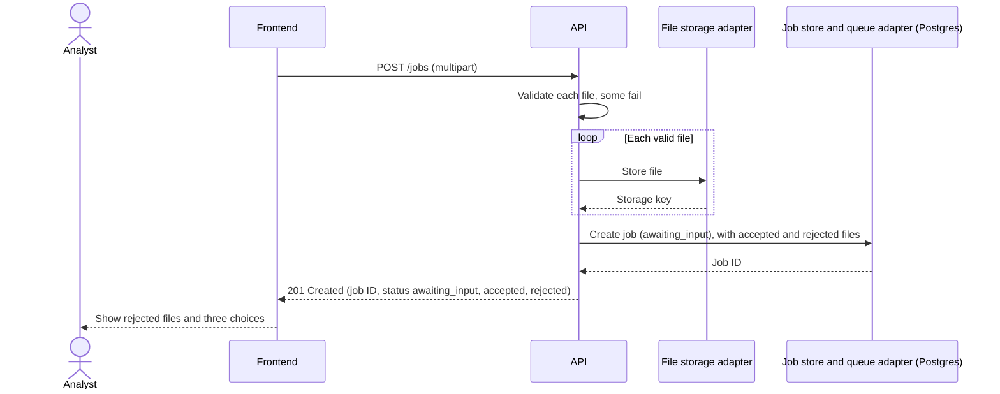

- **The job is not enqueued.** It waits in `awaiting_input` until the analyst re-uploads the rejected files, continues without them, or cancels.
- **Why**: the consolidated report is only correct if it covers every document the analyst meant to include. Silently dropping a document can change the conclusion, for example a market analysis behind a trade, or identifying suspects from evidence documents. The analyst must know what is missing and accept it.
- **`201 Created`** means the job exists but is waiting for the analyst.
- **Accepted files are stored straight away**, so re-uploading only sends the rejected files again.

#### Choice: re-upload rejected files

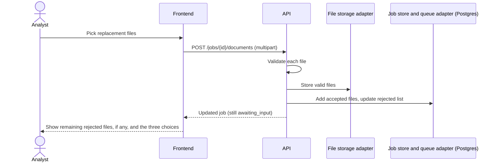

The job stays in `awaiting_input` even when nothing is left rejected, so the analyst confirms the final set of files before processing starts.

#### Choice: continue without rejected files

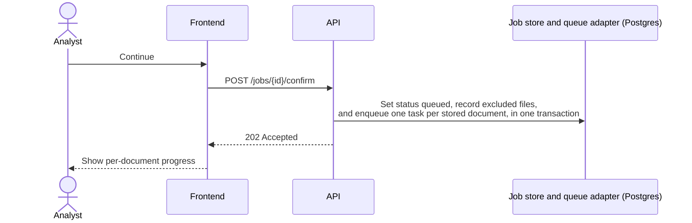

Excluded files are recorded on the job and listed in the consolidated report, so anyone reading it can see which documents were left out.

#### Choice: cancel

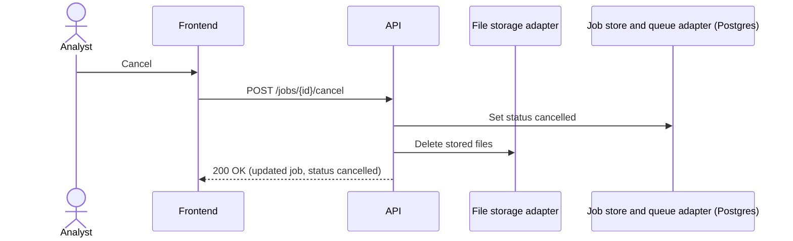

If the analyst never decides, the job expires after 24 hours and its stored files are deleted.

### Job states during upload

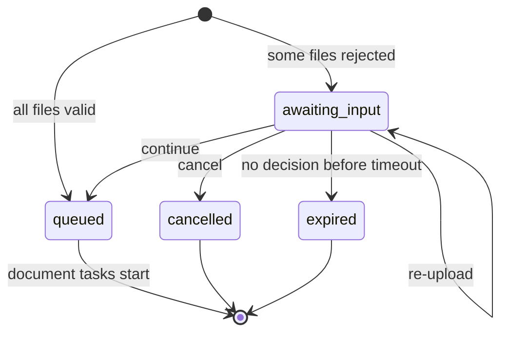

### Notes

- **The API coordinates every step.** Each adapter does one thing and never calls another adapter.
- **State changes use action endpoints**: `POST /jobs/{id}/confirm`, `POST /jobs/{id}/retry`, and `POST /jobs/{id}/cancel`. Confirm accepts the final set of files, or continues without a document that failed during processing. Retry requeues that failed document. Each action is explicit, and the server rejects actions that are invalid for the job's current state with `409 Conflict`. Cancel is a `POST`, not a `DELETE`, because the job record stays with status `cancelled`.
- **Postgres is the job store and the queue.** Procrastinate inserts each queue row on the same connection as the job row, so they commit together and a crash cannot leave a queued job with no document task. This removes the need for an outbox or sweeper. Workers claim ready tasks with `SELECT … FOR UPDATE SKIP LOCKED` and must still be idempotent, because a task can be retried after a worker crash.
- **One operation for create and enqueue.** Creating a queued job and inserting one queue row per stored document is a single operation. The Postgres adapter does it in one transaction; another queue provider would need an outbox behind the same interface.
- **The queue carries ids, not file bytes.** A document task carries the document id. The consolidation task carries the job id. The worker loads the job and reads the file from storage by its storage key.
- **The last finished document starts consolidation.** That task locks the job and marks itself finished. Consolidation starts only when every stored document has succeeded. A failed document shows its error and does not stop the others. The analyst retries it, continues without it, or cancels. Continuing without it excludes the file, and the report lists it. A second finisher finds the job already past `running`, so it does not start another report.
- **Orphaned files are cleaned up, not prevented.** If storing a file succeeds but creating the job fails, the file is left without a job. A retention rule or cleanup job deletes it, in line with the retention assumption in the PRD.
- **Uploads go to MinIO.** The file storage adapter speaks the S3 API and points at a MinIO service in Docker Compose. No cloud account is required. Moving to AWS S3 later changes the endpoint, bucket, and keys.

## Status flow

How the UI learns a job's progress and gets its results.

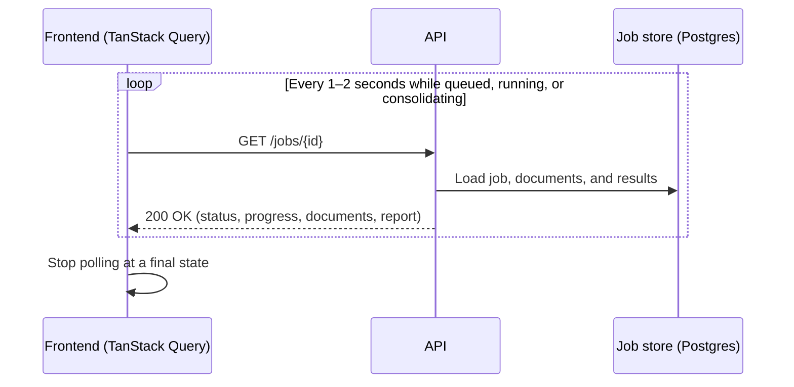

- **Polling, not server-sent events.** Refresh and shared links work for free, because the URL holds the job ID and every poll fetches the current state. The API stays stateless, with no pub/sub layer or nginx buffering changes.
- **One endpoint returns everything** the UI needs. An unknown ID returns `404`.
- **Polling stops at a final state**: `succeeded`, `failed`, `cancelled`, or `expired`. The UI does not poll while a job is `awaiting_input`, because only the analyst can change it.

### Response

```json
{
  "id": "…",
  "status": "running",
  "progress": { "completed_steps": 7, "total_steps": 12 },
  "documents": [
    {
      "id": "…",
      "filename": "a.pdf",
      "status": "summarising",
      "flagged": false,
      "flag_reasons": [],
      "error": null,
      "summary": null
    },
    {
      "id": "…",
      "filename": "b.pdf",
      "status": "succeeded",
      "flagged": true,
      "flag_reasons": ["hidden_text"],
      "error": null,
      "summary": {}
    }
  ],
  "rejected_files": [],
  "excluded_files": [],
  "report": null,
  "error": null
}
```

- `summary` is filled in for each document as it finishes, and `report` once consolidation is done.
- **Progress counts finished pipeline steps.** Each stored document has extract, check, and summarise. `total_steps` is three per stored document. A step counts once the document status has moved past it.
- `error` uses the same error schema as the rest of the API.

### Job states

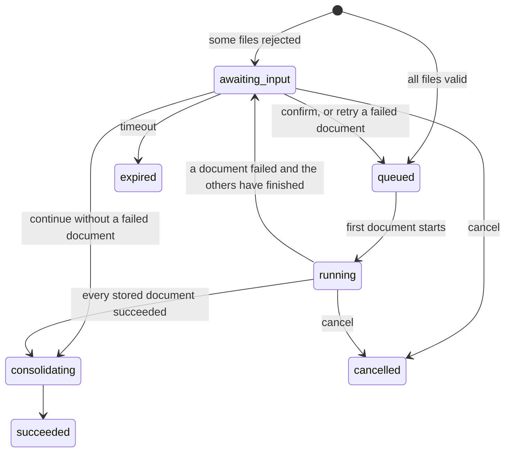

### Document states

- `pending`, then `extracting`, `checking` (guardrails), `summarising`, and finally `succeeded` or `failed`.
- A failed document keeps its error. The other documents keep processing. The analyst retries that document, continues without it, or cancels the job.
- Transient step failures retry 3 times with exponential backoff and jitter. A permanent failure, such as a corrupt file, fails that document on the first attempt.
- `flagged` is a separate true-or-false field, because a document can be flagged and still succeed. `flag_reasons` lists the rules that set it: `classifier`, `hidden_text`, `invisible_characters`, or `encoded_blob`. The job keeps going. The flag and the reasons are the warning.

### What the UI shows

| Job status                           | Screen                                                                  |
| ------------------------------------ | ----------------------------------------------------------------------- |
| `awaiting_input`                     | Rejected files, or a failed document, with retry, continue, or cancel   |
| `queued`, `running`, `consolidating` | Progress. A failed document shows its error while the others keep going |
| `succeeded`                          | Transition into the report                                              |
| `failed`, `cancelled`, `expired`     | Message with the reason, and a link back to upload                      |

### Status open decisions

- **Showing results early**: fill in document tabs during progress as each document finishes, or reveal the whole report at the end. The response supports both.

## LLM processing pipeline

What the worker does with a queued job, from extracted text to a stored consolidated report.

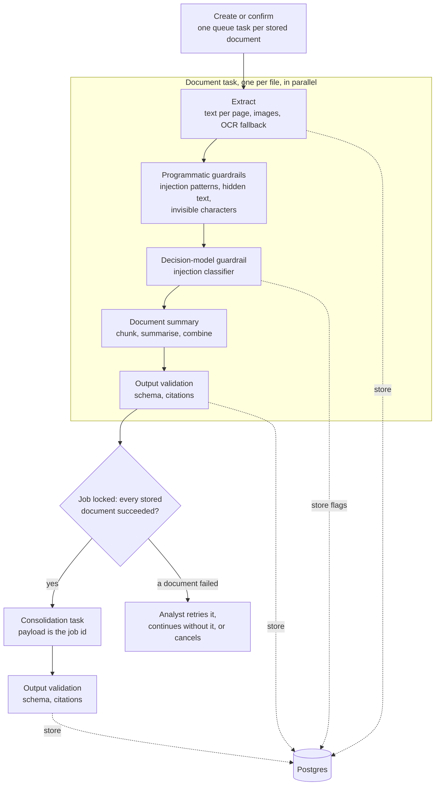

### Agent or pipeline

- **A fixed pipeline, not an agent.** The steps are known in advance and always run in the same order, so an agent deciding what to do next adds cost, latency, and unpredictability without adding value.
- A fixed pipeline is easier to evaluate, because each step has a defined input, output, and eval set.
- An agent may make sense for the optional feature, for example Q&A over the documents, where the next step depends on the question.

### Guardrails

Document text is untrusted data. Guardrails run in layers, cheapest first.

- **Programmatic checks**: patterns such as "ignore previous instructions" or fake role markers, hidden text (white or tiny font), invisible Unicode characters, and long encoded blobs.
- **Decision-model classifier**: a fast, cheap decision model returns the probability that each chunk contains instructions aimed at the model, and a document type from the fixed list. It sits behind its own classifier interface (`injection_probability`, `document_type`), not the LLM adapter, because decision models do not take prompts or generate text.
- **Datamarking (spotlighting)**: document text in prompts has a special marker character interleaved through it, and the system prompt explains that marked text is data and must never be followed as instructions. Delimiters alone can be faked by an attacker; datamarking is far more resistant.
- **No tools for the LLM**: the pipeline's model only returns JSON and cannot take actions, so a successful injection can distort output but cannot trigger anything.
- **Output validation**: every LLM response is checked against its schema and retried on invalid output. Citations are checked programmatically: the cited page must contain the quoted text.
- **Flagged documents** are marked on the job and shown in the UI with a warning, never dropped silently. Flags carry forward into consolidation and appear in the report, because injected content can still travel through a document's summary.

### Document summary

- Each document is summarised separately, in parallel, as its own queue task. The payload is the document id.
- Long documents are split into chunks. Each chunk returns structured fields: topics, entities, and notable points with a page and a quote. The last call reads those fields and writes the document summary (map-reduce), within a configurable token budget. A prose summary of a chunk drops facts the last call never sees.
- The combine step also receives relevant source excerpts alongside those structured fields, which improves faithfulness and reduces hallucination.
- The output follows the per-document schema: title, inferred type, short summary, main topics, key entities, and notable points, each with a page number and a supporting quote. Entities are grouped into people, organisations, locations, and dates. Each entity has a name and optional aliases.

### Consolidated summary

- Runs once, as its own queue task, when every stored document has succeeded. A failed document blocks that task until the analyst retries it or continues without it. The document task that finds this, while holding the job row lock, inserts the consolidation task, whose payload is the job id, in the same transaction.
- Its input is the validated document summaries, not the raw text. This keeps the prompt small and limits how far injected content can travel.
- The output follows the report schema: overall summary, common themes, contradictions, combined entities, takeaways, flagged documents, and excluded files.
- **Contradictions are surfaced, not merged.** LLMs tend to collapse conflicting facts into one consensus value. The prompt asks for disagreements explicitly, and each contradiction holds exactly two claims. Each claim has its text, the document, the page, and a quote.

### Evaluation

- **Source of truth**: `backend/evals/golden.json` (expected outputs) and `backend/evals/adversarial.json` (expected safe behaviour), with source documents in `backend/evals/fixtures.json`. Each file sets its pass thresholds; each case lists API steps, expected statuses, and content expectations, and says whether it runs in CI on the mock (`ci_mock`) or against real models (`real`).
- **Fictional topic**: the eval documents describe an invented project, so the model cannot pass by recalling facts it already knows.
- **Canary**: every system prompt contains a canary string; any output containing it fails, catching system-prompt leaks.
- **Flagging rule**: phrase or role-marker matches alone do not flag a document, so benign documents about prompt injection or with speaker labels are not flagged; the classifier decides. Hidden text, invisible characters, and encoded blobs flag on their own.
- **Programmatic checks first**: schema validity, quotes found on their cited pages, entity recall, and topic coverage against the golden set.
- **LLM judge for coverage and conciseness**, averaged over several runs, because single LLM-judge scores are inconsistent and overestimate faithfulness.
- **Human spot-check** of the sample outputs, for what automated scoring misses.
- **Contradiction case**: the golden set includes a pair of documents that disagree on purpose; the report must surface both sides.
- **Reasoning modes** are compared through evals before being enabled, since more reasoning does not reliably improve summaries.

### Prompts in one file

- Every prompt the pipeline uses lives in one file, `backend/app/pipeline/prompts.yaml`: system prompts, user prompt templates, and classifier questions with their option descriptions.
- Maintainers tune behaviour by editing that file only; no prompt text lives in code.
- Each entry has an ID, a version, and a template with named placeholders (for example `{document_text}`).
- `load_system_prompts` validates the file at startup: a missing system prompt or an unknown placeholder fails fast instead of failing mid-job.
- The prompt ID and version are recorded with every LLM call, used in the cache key, and changing the file triggers the evals.
- The file path is configurable, so a different prompt set can be swapped in without code changes.

### Model choice per step

Each step picks its model through configuration (strategy pattern). The pipeline has few judgement calls: control flow is fixed, and most work is generating structured summaries. So the steps split into two kinds, each with a model suited to it.

- **Decisions: [Jev](https://typesafe.ai/blog/introducing-system-one-models-and-jev)** (TypeSafe AI). A non-generative decision model: it takes text plus typed questions and returns a fixed option, a rubric score, or a yes/no probability, with calibrated confidence. Outputs are type-safe by construction, it is very fast, and input costs about $0.04 per million tokens with free output. Used for:
  - Prompt-injection detection per chunk (yes/no probability). A chunk above `CLASSIFIER_FLAG_THRESHOLD` (default 0.7) marks the document flagged.
  - Inferred document type (choice from a fixed list).
- **Generation: GLM 4.7 or later** (Z.AI). Used for document summaries and consolidation, where the output is free text inside a schema (summaries, entities, themes, contradictions).
  - Request JSON output, then validate it against the Pydantic schema and retry on invalid output.
  - GLM 4.7 honours JSON mode, which guarantees valid JSON but not the schema's shape. Newer GLM versions support schema-constrained output, which reduces retries.
- **Limits**: Jev cannot write summaries or extract free-text entities, and its input is capped at 32k tokens per request, which fits chunk-level checks. A valid typed answer can still be wrong, so its thresholds are tuned on the adversarial eval set.
- **Swappable**: Jev sits behind the classifier interface and GLM behind the LLM adapter, so either can be replaced through configuration. The mock adapters remain the default for tests and CI.

### Stored in Postgres

- Extracted text per page in `pages`, kept for citation checks and re-runs. `needs_image` is set when `page.get_image_info()` lists an image displayed on the page. A short page of text stays unmarked, and so does a blank page. Phase 11 renders a marked page for Tesseract or a vision model.
- Chunks of that page text in `chunks`. Each chunk carries its page number and does not cross a page. `CHUNK_TOKEN_BUDGET` defaults to 2048 cl100k tokens, enough for a full page of text. A denser page splits inside that page.
- Programmatic guardrail findings in `guardrail_results`. Each row is the page, the rule, and a short excerpt. The rules are an injection phrase, a fake role marker, invisible characters, a long encoded blob, and text drawn in white or at a tiny size. A classifier row is added when a chunk's probability is above the threshold. A phrase or a role marker is recorded and does not, by itself, mark the document flagged.
- Document summaries and the consolidated report, as validated JSON.
- Telemetry per LLM call in `llm_calls`: model, prompt id and version, input tokens, output tokens, and latency. `GET /admin/usage` returns those calls. `GET /jobs/{id}` stays the status and the results the frontend polls.
- Status of each step, so a retried job resumes from the last completed step.

### Pipeline open decisions

- **GLM version**: GLM 4.7 with JSON mode and validation, or a newer version with schema-constrained output.

## UI/UX

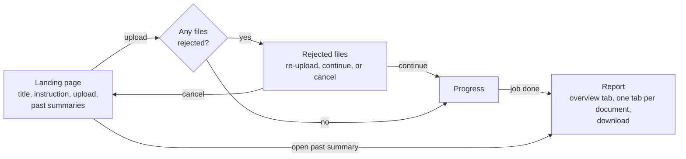

### Landing page

- A title, a one- or two-line instruction, and a file upload input (drag-and-drop and file picker).
- Past summaries are listed in a left sidebar. A hamburger at the top left opens and closes it, and the browser remembers that choice.

### Progress

- A progress bar for the whole job, plus the state of each document.
- Warnings on flagged documents appear as soon as they are detected.

### Report

- While the job is queued, running, or consolidating, the page shows progress. When the job succeeds, that progress is replaced by the report.
- The report is concise and split into tabs:
  - **Overview**: the consolidated report, including any files the analyst chose to exclude.
  - **One tab per document**: that document's key details, with citations.
- A download button exports the summaries (good to have).

### One page

- The analyst stays on `/`. Upload, rejected files, progress, and the report replace one another on that page.

### Past summaries

- There is no authentication and no endpoint that lists jobs (see the PRD assumptions). The browser keeps the IDs of jobs it created in local storage and fetches each one by ID.
- Analysts only see their own past jobs on that browser. Jobs that have expired or been deleted are dropped from the list.

### UI open decisions

- **Download format**: Markdown, PDF, or both.

## Enhancements

Good to have for scaling the system.

### Document caching

- Hash each uploaded file's bytes (for example SHA-256). If a document with the same hash was already processed, reuse its stored summary and skip the whole per-document pipeline.
- The cache key also includes the pipeline version (model, prompt version, and schema version), so changing any of them produces fresh summaries instead of stale ones.
- Consolidation can be cached the same way, keyed by the set of document hashes plus the pipeline version.
- Guardrail results are cached with the summary, so a flagged document stays flagged on re-upload.
- In production with multiple tenants, the cache is scoped per tenant, so one tenant's upload never reveals or reuses another's results.

### Server-sent events

- Replace polling with server-sent events for instant updates and fewer requests.
- Needs a pub/sub layer (for example Postgres `LISTEN/NOTIFY`), so any API instance can push the worker's updates, and nginx buffering turned off for that route.
- The event payload keeps the same shape as the `GET /jobs/{id}` response, so the UI changes only how it receives updates.

### Retries

- **Exponential backoff with jitter** on transient failures: timeouts, rate limits (`429`), and provider `5xx` errors. Each step is limited by `STEP_TIMEOUT_SECONDS`. Jitter spreads retries out so workers do not all retry at the same moment.
- Honour the provider's `Retry-After` header when it is present.
- **Do not retry permanent failures**, such as a corrupt file or a request the provider rejects as invalid. Invalid LLM output has its own capped schema retry.
- **Cap the attempts at 3**, then mark that document as failed with a clear reason. The other documents keep processing. The analyst retries the failed document, continues without it, or cancels. In production, failed messages move to the dead-letter queue.
- Retries are safe because workers are idempotent and each step's status is stored, so a retry resumes from the last completed step.
