# Architecture

Solution design for doc-insight. Product requirements live in [PRD.md](PRD.md), the architectural rules in [direction.md](direction.md), and the literature behind the pipeline design in [industry-insights.md](industry-insights.md).

## System components (POC)

_This is what we are building._

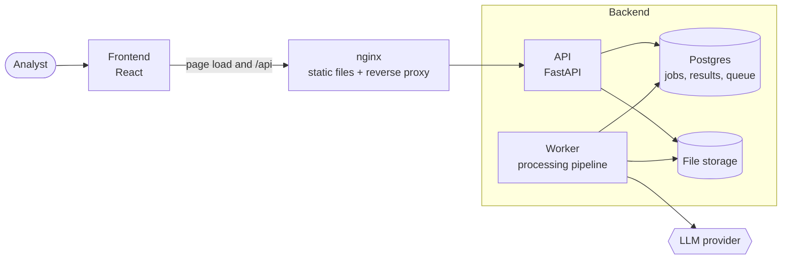

## System components (production AWS)

_Envisioned architecture if we were to go to production._ These parts swap in through adapters, with no changes to API or worker logic:

- **Queue**: Postgres queue to SQS, with an outbox behind the same create-and-enqueue operation.
- **File storage**: local storage to S3.
- **LLM provider**: mock or hosted model to Bedrock or another provider.
- **Job store**: Postgres to RDS Postgres, a configuration change only.

Hosting (nginx to CloudFront and a load balancer) is an infrastructure change, not a code change. Authentication with Cognito is new work, not a swap.

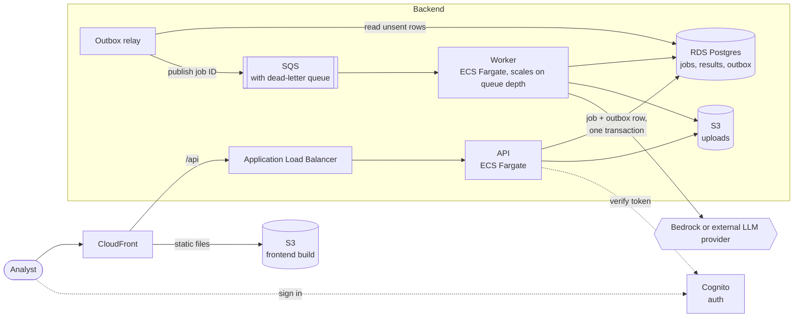

## Upload flow

What happens from the moment the analyst selects files until the job is queued. Processing by the worker is a separate flow.

A job only starts when every file is accepted, or when the analyst explicitly chooses to continue without the rejected ones.

### Happy path: all files valid

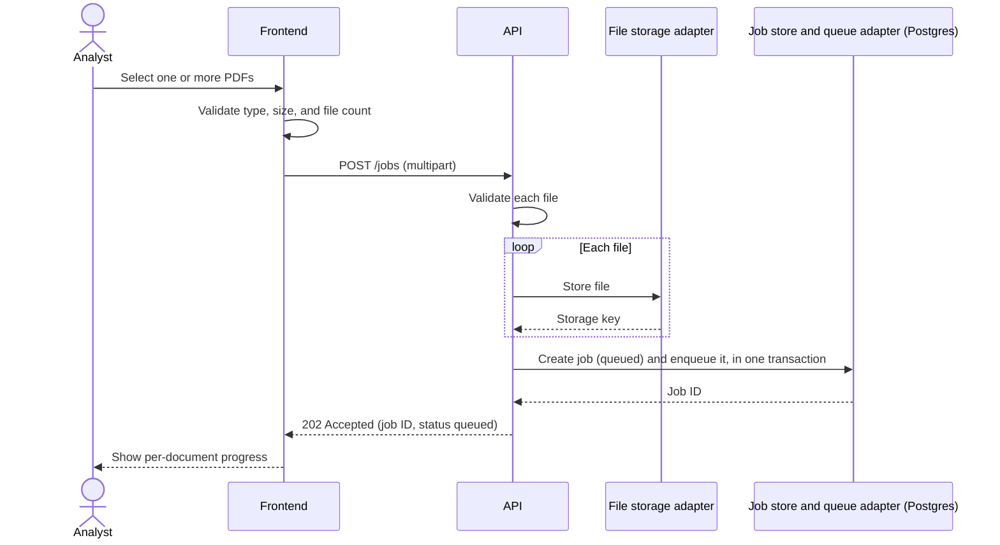

- **Validation happens twice.** The client check gives fast feedback. The server check is the one that is enforced, because client checks can be bypassed.
- **Server validation** checks MIME type, `%PDF` magic bytes, size, page count, encryption, and JavaScript or embedded files.
- **Files rejected on the client** are shown with reasons before upload, so the analyst can replace or remove them first.
- **`202 Accepted`** means the job is queued, not that it has finished. The UI follows progress through the [status flow](#status-flow).

### Negative case: all files rejected

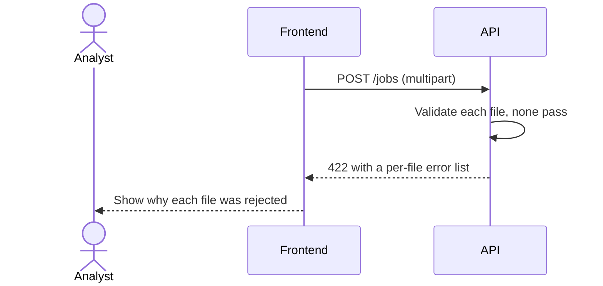

No files are stored and no job is created, so there is nothing to clean up. The analyst selects new files and starts again.

### Negative case: some files rejected

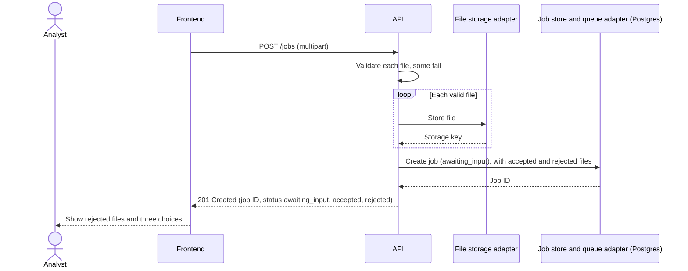

- **The job is not enqueued.** It waits in `awaiting_input` until the analyst re-uploads the rejected files, continues without them, or cancels.
- **Why**: the consolidated report is only correct if it covers every document the analyst meant to include. Silently dropping a document can change the conclusion, for example a market analysis behind a trade, or identifying suspects from evidence documents. The analyst must know what is missing and accept it.
- **`201 Created`** means the job exists but is waiting for the analyst.
- **Accepted files are stored straight away**, so re-uploading only sends the rejected files again.

#### Choice: re-upload rejected files

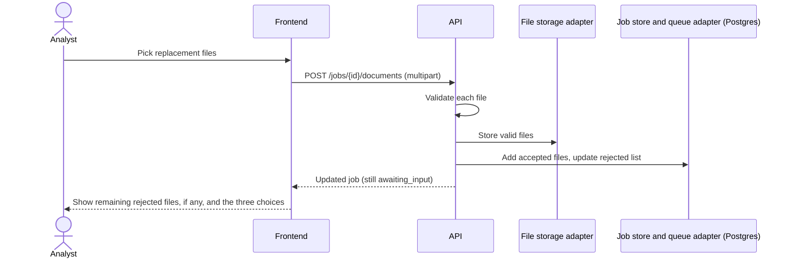

The job stays in `awaiting_input` even when nothing is left rejected, so the analyst confirms the final set of files before processing starts.

#### Choice: continue without rejected files

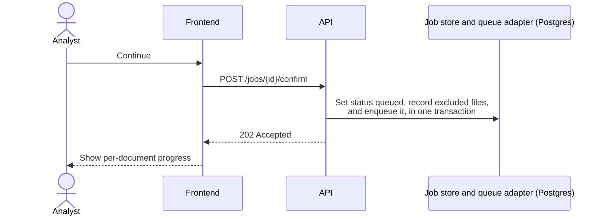

Excluded files are recorded on the job and listed in the consolidated report, so anyone reading it can see which documents were left out.

#### Choice: cancel

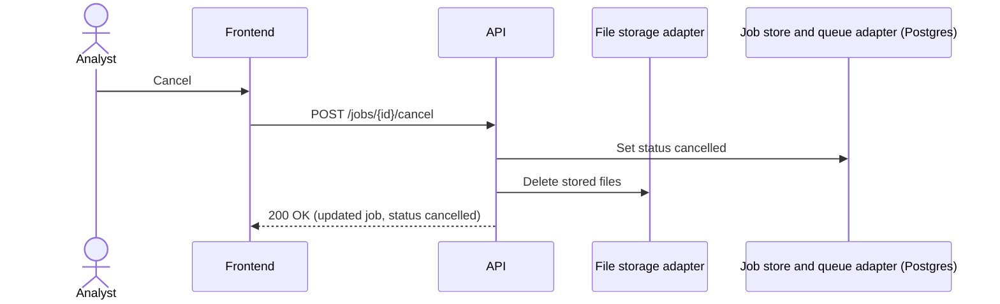

If the analyst never decides, the job expires after a configurable timeout and its stored files are deleted.

### Job states during upload

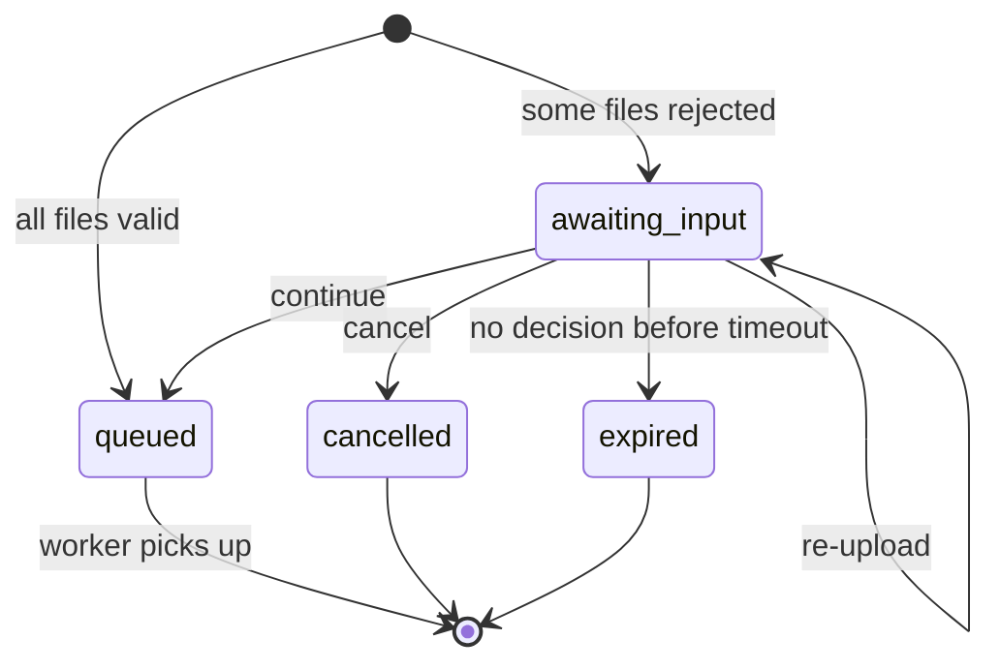

### Notes

- **The API coordinates every step.** Each adapter does one thing and never calls another adapter.
- **State changes use action endpoints**: `POST /jobs/{id}/confirm` and `POST /jobs/{id}/cancel`. Confirm means the analyst accepts the final set of files and processing can start. Each action is explicit, and the server rejects actions that are invalid for the job's current state with `409 Conflict`. Cancel is a `POST`, not a `DELETE`, because the job record stays with status `cancelled`.
- **Postgres is the job store and the queue.** Creating a job and enqueuing it happen in one transaction, so a crash cannot leave a queued job with no message. This removes the need for an outbox or sweeper. Workers claim ready jobs with `SELECT … FOR UPDATE SKIP LOCKED` and must still be idempotent, because a job can be retried after a worker crash.
- **One operation for create and enqueue.** Because the two writes are atomic, the adapter interface exposes them as a single operation. The Postgres adapter does it in one transaction; another queue provider would need an outbox behind the same interface.
- **Only the job ID goes on the queue.** The worker loads the job from the job store and reads files from file storage by their storage keys.
- **Orphaned files are cleaned up, not prevented.** If storing a file succeeds but creating the job fails, the file is left without a job. A retention rule or cleanup job deletes it, in line with the retention assumption in the PRD.

### Open decisions

- **File storage baseline**: a shared Docker volume, or MinIO so the S3 adapter is exercised locally.
- **Queue library**: Procrastinate or PGQueuer. Pick the one that can enqueue on the same connection and transaction that creates the job.
- **Error codes for limits**: whether oversized uploads or too many files return `413`, or are folded into the `422` per-file error list.
- **Failures during processing**: whether the same choice applies when a document fails later (for example extraction or LLM failure), by pausing before consolidation.
- **Timeout for `awaiting_input`**: how long a job waits for a decision before it expires.

## Status flow

How the UI learns a job's progress and gets its results.

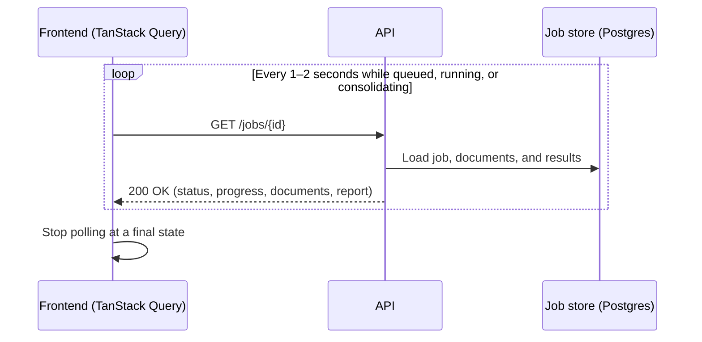

- **Polling, not server-sent events.** Refresh and shared links work for free, because the URL holds the job ID and every poll fetches the current state. The API stays stateless, with no pub/sub layer or nginx buffering changes.
- **One endpoint returns everything** the UI needs. An unknown ID returns `404`.
- **Polling stops at a final state**: `succeeded`, `failed`, `cancelled`, or `expired`. The UI does not poll while a job is `awaiting_input`, because only the analyst can change it.

### Response

```json
{
  "id": "…",
  "status": "running",
  "progress": { "completed_steps": 7, "total_steps": 12 },
  "documents": [
    {
      "id": "…",
      "filename": "a.pdf",
      "status": "summarising",
      "flagged": false,
      "error": null,
      "summary": null
    },
    {
      "id": "…",
      "filename": "b.pdf",
      "status": "succeeded",
      "flagged": true,
      "error": null,
      "summary": {}
    }
  ],
  "rejected_files": [],
  "excluded_files": [],
  "report": null,
  "error": null
}
```

- `summary` is filled in for each document as it finishes, and `report` once consolidation is done.
- `error` uses the same error schema as the rest of the API.

### Job states

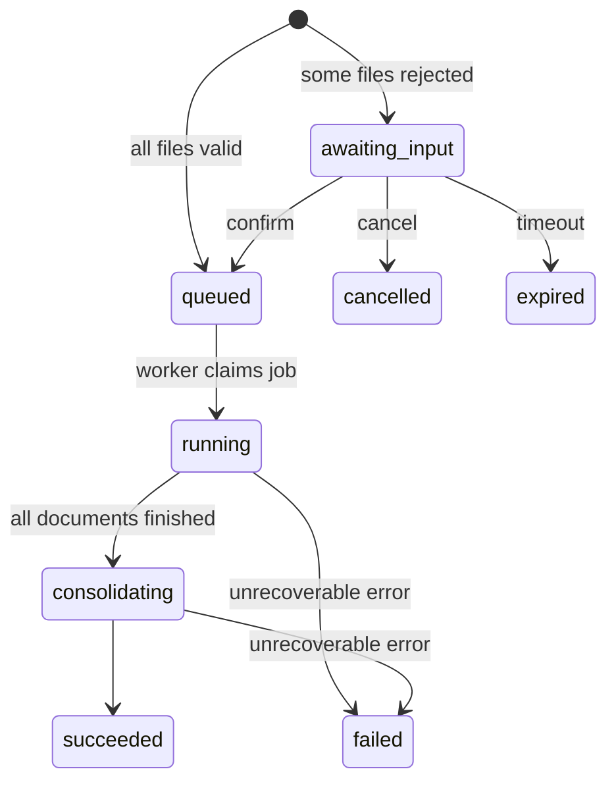

### Document states

- `pending`, then `extracting`, `checking` (guardrails), `summarising`, and finally `succeeded` or `failed`.
- `flagged` is a separate true-or-false field, because a document can be flagged and still succeed.

### What the UI shows

| Job status                           | Screen                                             |
| ------------------------------------ | -------------------------------------------------- |
| `awaiting_input`                     | Rejected files with the three choices              |
| `queued`, `running`, `consolidating` | Progress bar, document states, and flags           |
| `succeeded`                          | Transition into the report                         |
| `failed`, `cancelled`, `expired`     | Message with the reason, and a link back to upload |

### Status open decisions

- **Showing results early**: fill in document tabs during progress as each document finishes, or reveal the whole report at the end. The response supports both.

## LLM processing pipeline

What the worker does with a queued job, from extracted text to a stored consolidated report.

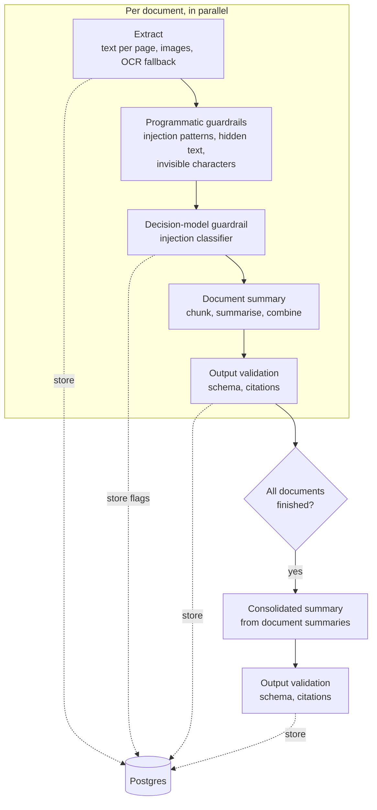

### Agent or pipeline

- **A fixed pipeline, not an agent.** The steps are known in advance and always run in the same order, so an agent deciding what to do next adds cost, latency, and unpredictability without adding value.
- A fixed pipeline is easier to evaluate, because each step has a defined input, output, and eval set.
- An agent may make sense for the optional feature, for example Q&A over the documents, where the next step depends on the question.

### Guardrails

Document text is untrusted data. Guardrails run in layers, cheapest first.

- **Programmatic checks**: patterns such as "ignore previous instructions" or fake role markers, hidden text (white or tiny font), invisible Unicode characters, and long encoded blobs.
- **Decision-model classifier**: a fast, cheap decision model returns the probability that each chunk contains instructions aimed at the model. It sits behind its own classifier interface (`classify(text) -> label, score`), not the LLM adapter, because decision models do not take prompts or generate text.
- **Datamarking (spotlighting)**: document text in prompts has a special marker character interleaved through it, and the system prompt explains that marked text is data and must never be followed as instructions. Delimiters alone can be faked by an attacker; datamarking is far more resistant.
- **No tools for the LLM**: the pipeline's model only returns JSON and cannot take actions, so a successful injection can distort output but cannot trigger anything.
- **Output validation**: every LLM response is checked against its schema and retried on invalid output. Citations are checked programmatically: the cited page must contain the quoted text.
- **Flagged documents** are marked on the job and shown in the UI with a warning, never dropped silently. Flags carry forward into consolidation and appear in the report, because injected content can still travel through a document's summary.

### Document summary

- Each document is summarised separately, in parallel, as its own queue task.
- Long documents are split into chunks. Each chunk is summarised, then the chunk summaries are combined into the document's key details (map-reduce), within a configurable token budget.
- The combine step receives relevant source excerpts alongside the chunk summaries, which improves faithfulness and reduces hallucination.
- The output follows the per-document schema: title, inferred type, short summary, main topics, key entities, and notable points, each with a page number and a supporting quote.

### Consolidated summary

- Runs once every document in the job has finished (fan-in).
- Its input is the validated document summaries, not the raw text. This keeps the prompt small and limits how far injected content can travel.
- The output follows the report schema: overall summary, common themes, contradictions, combined entities, takeaways, flagged documents, and excluded files.
- **Contradictions are surfaced, not merged.** LLMs tend to collapse conflicting facts into one consensus value. The prompt asks for disagreements explicitly, and each contradiction lists both claims, each with its document and page.

### Evaluation

- **Source of truth**: `backend/evals/golden.json` (expected outputs) and `backend/evals/adversarial.json` (expected safe behaviour), with source documents in `backend/evals/fixtures.json`. Each file sets its pass thresholds; each case lists API steps, expected statuses, and content expectations, and says whether it runs in CI on the mock (`ci_mock`) or against real models (`real`).
- **Fictional topic**: the eval documents describe an invented project, so the model cannot pass by recalling facts it already knows.
- **Canary**: every system prompt contains a canary string; any output containing it fails, catching system-prompt leaks.
- **Flagging rule**: phrase or role-marker matches alone do not flag a document, so benign documents about prompt injection or with speaker labels are not flagged; the classifier decides. Hidden text, invisible characters, and encoded blobs flag on their own.
- **Programmatic checks first**: schema validity, quotes found on their cited pages, entity recall, and topic coverage against the golden set.
- **LLM judge for coverage and conciseness**, averaged over several runs, because single LLM-judge scores are inconsistent and overestimate faithfulness.
- **Human spot-check** of the sample outputs, for what automated scoring misses.
- **Contradiction case**: the golden set includes a pair of documents that disagree on purpose; the report must surface both sides.
- **Reasoning modes** are compared through evals before being enabled, since more reasoning does not reliably improve summaries.

### Prompts in one file

- Every prompt the pipeline uses lives in one file, `backend/app/pipeline/prompts.yaml`: system prompts, user prompt templates, and Jev questions with their option descriptions.
- Maintainers tune behaviour by editing that file only; no prompt text lives in code.
- Each entry has an ID, a version, and a template with named placeholders (for example `{document_text}`).
- The file is loaded and validated at startup: a missing prompt or an unknown placeholder fails fast instead of failing mid-job.
- The prompt ID and version are recorded with every LLM call, used in the cache key, and changing the file triggers the evals.
- The file path is configurable, so a different prompt set can be swapped in without code changes.

### Model choice per step

Each step picks its model through configuration (strategy pattern). The pipeline has few judgement calls: control flow is fixed, and most work is generating structured summaries. So the steps split into two kinds, each with a model suited to it.

- **Decisions: [Jev](https://typesafe.ai/blog/introducing-system-one-models-and-jev)** (TypeSafe AI). A non-generative decision model: it takes text plus typed questions and returns a fixed option, a rubric score, or a yes/no probability, with calibrated confidence. Outputs are type-safe by construction, it is very fast, and input costs about $0.04 per million tokens with free output. Used for:
  - Prompt-injection detection per chunk (yes/no probability, with a configurable threshold).
  - Inferred document type (choice from a fixed list).
- **Generation: GLM 4.7 or later** (Z.AI). Used for document summaries and consolidation, where the output is free text inside a schema (summaries, entities, themes, contradictions).
  - Request JSON output, then validate it against the Pydantic schema and retry on invalid output.
  - GLM 4.7 honours JSON mode, which guarantees valid JSON but not the schema's shape. Newer GLM versions support schema-constrained output, which reduces retries.
- **Limits**: Jev cannot write summaries or extract free-text entities, and its input is capped at 32k tokens per request, which fits chunk-level checks. A valid typed answer can still be wrong, so its thresholds are tuned on the adversarial eval set.
- **Swappable**: Jev sits behind the classifier interface and GLM behind the LLM adapter, so either can be replaced through configuration. The mock adapters remain the default for tests and CI.

### Stored in Postgres

- Extracted text per page, kept for citation checks and re-runs.
- Guardrail results and flags per document.
- Document summaries and the consolidated report, as validated JSON.
- Telemetry per LLM call: model, prompt version, tokens, and latency.
- Status of each step, so a retried job resumes from the last completed step.

### Pipeline open decisions

- **Flagged documents**: process them with hardened prompts and a warning, or pause the job for the analyst to decide, as with rejected files.
- **PDF library**: PyMuPDF4LLM (fastest, AGPL licence, needs Tesseract for scanned pages) or Docling (MIT licence, slower, built-in layout, tables, and OCR).
- **GLM version**: GLM 4.7 with JSON mode and validation, or a newer version with schema-constrained output.
- **Injection threshold**: the Jev probability above which a chunk is flagged, tuned on the adversarial eval set.
- **Chunk size and token budget** per model.

## UI/UX

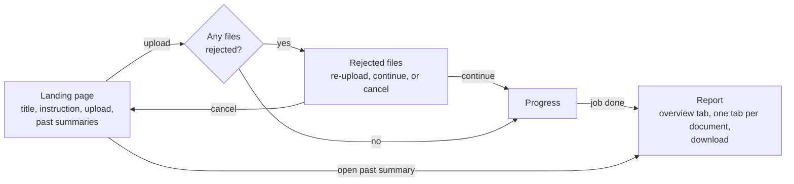

### Landing page

- A title, a one- or two-line instruction, and a file upload input (drag-and-drop and file picker).
- Past summaries are listed beside the upload (left sidebar) or below it.

### Progress

- A progress bar for the whole job, plus the state of each document.
- Warnings on flagged documents appear as soon as they are detected.

### Report

- When the job finishes, the page transitions smoothly from progress into the report.
- The report is concise and split into tabs:
  - **Overview**: the consolidated report, including any files the analyst chose to exclude.
  - **One tab per document**: that document's key details, with citations.
- A download button exports the summaries (good to have).

### URL tracks the job

- The page for a job lives at `/jobs/{id}`, so a refresh or a shared link reopens the same job.
- On load, the page fetches the job and shows whatever state it is in: rejected files awaiting a decision, progress, the report, or a failed, cancelled, or expired message.
- nginx already falls back to `index.html` for unknown paths, so a refresh on `/jobs/{id}` loads the app instead of a 404.

### Past summaries

- There is no authentication and no endpoint that lists jobs (see the PRD assumptions). The browser keeps the IDs of jobs it created in local storage and fetches each one by ID.
- Analysts only see their own past jobs on that browser. Jobs that have expired or been deleted are dropped from the list.

### UI open decisions

- **Past summaries placement**: left sidebar or below the upload.
- **Download format**: Markdown, PDF, or both.

## Enhancements

Good to have for scaling the system.

### Document caching

- Hash each uploaded file's bytes (for example SHA-256). If a document with the same hash was already processed, reuse its stored summary and skip the whole per-document pipeline.
- The cache key also includes the pipeline version (model, prompt version, and schema version), so changing any of them produces fresh summaries instead of stale ones.
- Consolidation can be cached the same way, keyed by the set of document hashes plus the pipeline version.
- Guardrail results are cached with the summary, so a flagged document stays flagged on re-upload.
- In production with multiple tenants, the cache is scoped per tenant, so one tenant's upload never reveals or reuses another's results.

### Server-sent events

- Replace polling with server-sent events for instant updates and fewer requests.
- Needs a pub/sub layer (for example Postgres `LISTEN/NOTIFY`), so any API instance can push the worker's updates, and nginx buffering turned off for that route.
- The event payload keeps the same shape as the `GET /jobs/{id}` response, so the UI changes only how it receives updates.

### Retries

- **Exponential backoff with jitter** on transient failures: timeouts, rate limits (`429`), and provider `5xx` errors. Jitter spreads retries out so workers do not all retry at the same moment.
- Honour the provider's `Retry-After` header when it is present.
- **Do not retry permanent failures**, such as a corrupt file or a request the provider rejects as invalid. Invalid LLM output has its own capped schema retry.
- **Cap the attempts**, then mark the document as failed with a clear reason. In production, failed messages move to the dead-letter queue.
- Retries are safe because workers are idempotent and each step's status is stored, so a retry resumes from the last completed step.
